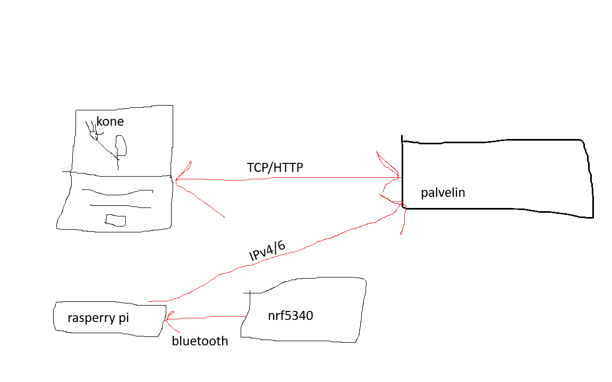

## Tietoliikenteen-sovellusprojekti (work in progress)

### Johdanto

Kyseessä on TVT25SPL-kouluprojekti toisen vuoden opiskelijoille. Projekissa tehdään tietokanta, johon tallennetaan Nordic Semiconductorsin nRF5340 DK -kitiltä saatua kiihtyvyydataa. Kiihtyvyysdata siirretään Internetin välityksellä koulun hostaamalle Linux-palvelimelle Kiihtyvyysdatalla opetetaan koneoppimismalli.

Projektin tavoitteena on tunnistaa ja ymmärtää ohjelmistokehityksen vaihejakomallin perusvaiheet esim. oliopohjaisen sovelluksen toteuttaminen, UML-kielen käyttö ja toteuttaa sovellukseen tietokanta-arkkitehtuuri.

### Ominaisuudet
ei toimi

### Työkalut ja laitteet (work in progress)

Visual Studio Code
- Visual Studio Codea hyödynnetään projektissa tarvittavan backendin tekemiseen.

J-Segger
- nRF5340 DK- laudan yhdistämiseen USB-liitännän kautta.

Github
- Toimii projektin ja dokumennoinnin etusivuna.

Arkkitehtuurikuva (work in progress)

